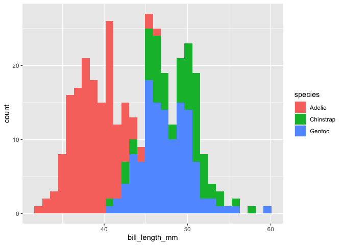
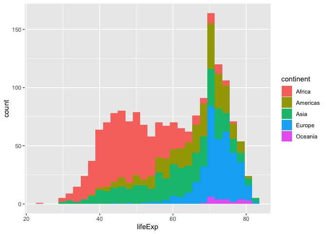

# assignmentB2JorgeEduardoHernandezRodriguez Package

The goal of assignmentB2JorgeEduardoHernandezRodriguez is to help people
to make a basic statistic summary and understand the distribution of the
data of a numerical variable grouped by a categorical variable in a
dataset.

## Installation

You can install the development version of
assignmentB2JorgeEduardoHernandezRodriguez from
[GitHub](https://github.com/) by calling:
`devtools::install_github("UBC-STAT545-F2026/Assignment2JorgeEduardoHernandezRodriguez", ref = "0.1.0")`

## Example

This is a basic example of how to use the package using 2 different
datasets:

``` r
library(assignmentB2JorgeEduardoHernandezRodriguez)
# install.packages("palmerpenguins")
library(palmerpenguins)
#> 
#> Attaching package: 'palmerpenguins'
#> The following objects are masked from 'package:datasets':
#> 
#>     penguins, penguins_raw
# install.packages("gapminder")
library(gapminder)

# Make a statistics summary and histogram plot of the numerical variable  "bill_lenght_mm" grouped by the categorical variable "species"
grouped_main_stats(palmerpenguins::penguins, species, bill_length_mm)
#> # A tibble: 3 × 5
#>   species   mean_bill_length_mm median_bill_length_mm min_bill_length_mm
#>   <fct>                   <dbl>                 <dbl>              <dbl>
#> 1 Adelie                   38.8                  38.8               32.1
#> 2 Chinstrap                48.8                  49.6               40.9
#> 3 Gentoo                   47.5                  47.3               40.9
#> # ℹ 1 more variable: max_bill_length_mm <dbl>
#> `stat_bin()` using `bins = 30`. Pick better value `binwidth`.
#> Warning: Removed 2 rows containing non-finite outside the scale range
#> (`stat_bin()`).
```



``` r

# Make a statistics summary and histogram plot of the numerical variable  "lifeExp" grouped by the categorical variable "continent"
grouped_main_stats(gapminder, continent, lifeExp)
#> # A tibble: 5 × 5
#>   continent mean_lifeExp median_lifeExp min_lifeExp max_lifeExp
#>   <fct>            <dbl>          <dbl>       <dbl>       <dbl>
#> 1 Africa            48.9           47.8        23.6        76.4
#> 2 Americas          64.7           67.0        37.6        80.7
#> 3 Asia              60.1           61.8        28.8        82.6
#> 4 Europe            71.9           72.2        43.6        81.8
#> 5 Oceania           74.3           73.7        69.1        81.2
#> `stat_bin()` using `bins = 30`. Pick better value `binwidth`.
```


